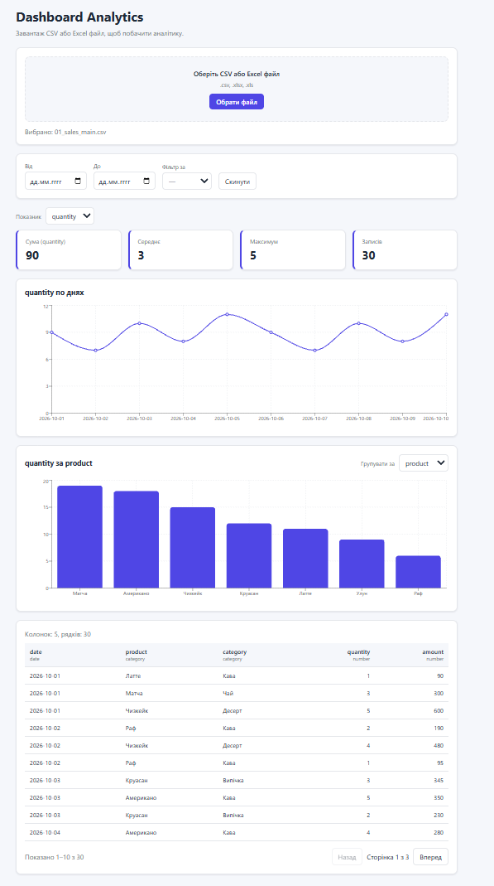
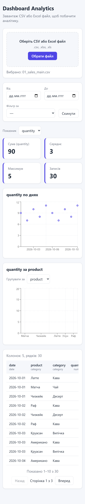

# Dashboard Analytics

Веб-застосунок, який перетворює CSV або Excel-таблицю на інтерактивний дашборд: сам визначає типи колонок, рахує статистику, будує графіки й дає фільтри та таблицю з сортуванням. Усе працює **в браузері**: файл нікуди не відправляється.

[**Демо:** _буде додано після деплою_](https://dashboard-analytics-ten-opal.vercel.app/)



## Можливості

- Завантаження **CSV** та **Excel** (`.xlsx`, `.xls`)
- **Автоматичне визначення типів колонок**: дата, число, категорія, текст
- Підтримка українських форматів: числа з комою (`1 234,56`), дати `dd.mm.yyyy`, кодування **UTF-8 та windows-1251**, роздільники `,` і `;`
- Картки зі статистикою: сума, середнє, максимум, кількість записів
- Графіки: динаміка по днях (лінійний) і розподіл за категоріями (стовпчиковий), із вибором показника та групування
- Фільтри за діапазоном дат і значенням категорії
- Таблиця з **сортуванням** за типом колонки та **пагінацією**
- Адаптивний інтерфейс (телефон, планшет, ПК)
- Зрозумілі повідомлення про помилки: невідомий формат, порожній файл, немає числових колонок

| Телефон |
| --- |
|  |

## Технології

- **React 19** + **TypeScript** (strict)
- **Vite 8** для збірки
- **Recharts 3** для графіків
- **PapaParse** для CSV, **SheetJS (xlsx)** для Excel
- **ESLint**, звичайний **CSS** зі змінними (без UI-бібліотек)

## Як це працює

Файл читається в браузері й перетворюється на таблицю (`columns` + `rows`). Далі:

1. **`detectColumnTypes`** бере перші 100 рядків. Якщо ≥ 90 % значень колонки є числами, це `number`; якщо датами, це `date`; якщо унікальних значень не більше 20, це `category`; інакше `text`.
2. **Фільтри** створюють відфільтровану копію таблиці, від якої залежать картки, графіки й таблиця.
3. **Агрегації** (`sumByDate`, `sumByCategory`, `summarize`) готують дані для графіків і карток.

## Структура проєкту

```
src/
├── components/     UI: FileUpload, Filters, StatCards, графіки, DataTable, Dashboard
├── lib/            чиста логіка без React:
│   ├── parseCsv.ts, parseExcel.ts, parseFile.ts     читання файлів
│   ├── detectColumnTypes.ts                          визначення типів
│   ├── filterRows.ts, aggregate.ts, stats.ts         фільтри й обчислення
│   └── sortRows.ts                                   сортування
├── App.tsx
└── index.css       стилі
samples/            приклад даних
docs/               скріншоти
```

Логіка винесена в `lib/` окремо від компонентів, тому її легко перевіряти й перевикористовувати.

## Запуск локально

Потрібен Node.js 22 або новіший.

```bash
git clone https://github.com/olehsochykanjr-boop/dashboard-analytics.git
cd dashboard-analytics
npm install
npm run dev
```

Відкрий `http://localhost:5173` і завантаж `samples/sales.csv`.

Інші команди:

```bash
npm run build     # продакшн-збірка
npm run lint      # перевірка ESLint
```

## Відомі обмеження

- Типи колонок визначаються за перших 100 рядків
- Колонка з понад 20 унікальними текстовими значеннями вважається текстом, а не категорією
- Підтримуються дати `yyyy-mm-dd` і `dd.mm.yyyy` (також з `/`)
- З Excel читається лише перший аркуш
- Дуже великі файли (сотні тисяч рядків) можуть працювати повільно, бо все обробляється в браузері

## Можливі покращення

- Автотести логіки з `lib/` (Vitest)
- Вибір аркуша в Excel
- Експорт відфільтрованих даних
- Темна тема

## Автор

Олег LiveCoding: [GitHub](https://github.com/olehsochykanjr-boop)